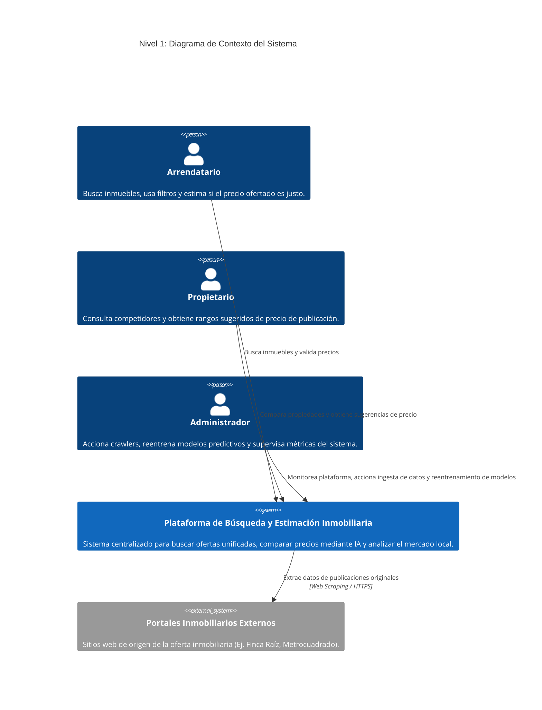
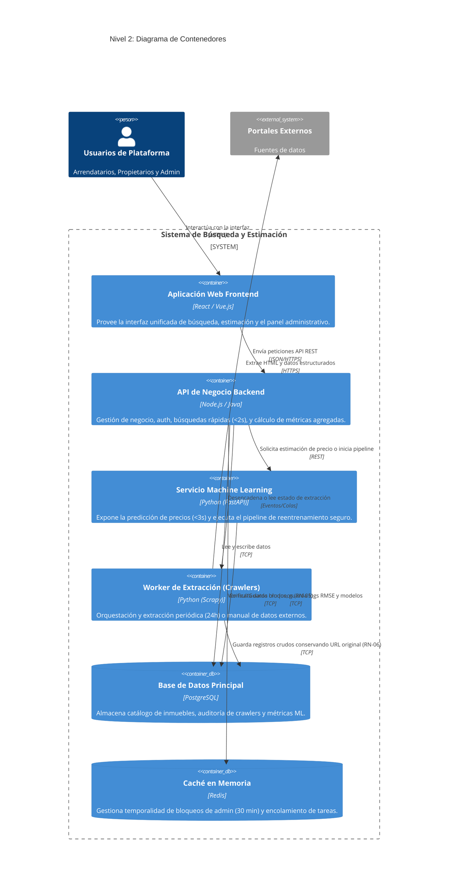
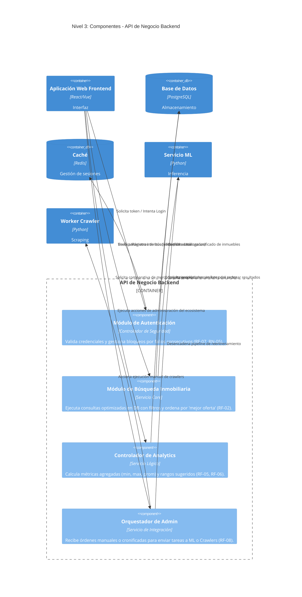
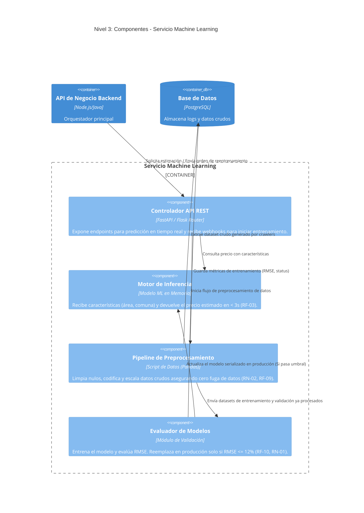

# Modelo C4: Sistema de Búsqueda y Estimación Inmobiliaria

El **Modelo C4** es un enfoque para visualizar la arquitectura de software a través de cuatro niveles de abstracción (Contexto, Contenedores, Componentes y Código). A continuación, se detalla la arquitectura para el sistema inmobiliario, vinculando los requisitos funcionales (RF) y reglas de negocio (RN) del proyecto.

---

## 1. Nivel 1: Contexto (Context)
**Objetivo:** Mostrar el panorama general. Documenta qué sistemas y qué actores interactúan con el software que estamos construyendo.

**Elementos:**
*   **Usuarios:** Arrendatario (busca/valida), Propietario (compara/pública) y Administrador (gestiona).
*   **Sistema Central:** Nuestra plataforma.
*   **Sistemas Externos:** Los portales de donde extraemos los datos.

---

## 2. Nivel 2: Contenedores (Containers)
**Objetivo:** Muestra la arquitectura de alto nivel. Desglosa el "Sistema Central" en aplicaciones, bases de datos, y microservicios desplegables separadamente.

**Elementos:**
*   **SPA Frontend:** La interfaz visual para todos los roles.
*   **API de Negocio:** Centraliza la lógica, los filtros rápidos (< 2s) y rutea el tráfico.
*   **Servicio ML:** Dedicado a la inferencia de precios y cálculo del pipeline de datos pesados para no bloquear el API.
*   **Worker Crawler:** Ejecuta la extracción (Web Scraping) en segundo plano (cada 24h).
*   **Bases de Datos & Caché:** PostgreSQL para persistencia y Redis para manejar sesiones bloqueadas y colas.

---

## 3. Nivel 3: Componentes (Components)
**Objetivo:** Hacemos zoom dentro de un contenedor específico para visualizar cómo está estructurado su código a nivel modular (controladores, servicios, repositorios). 

A continuación, mostramos los componentes de los dos contenedores principales: la **API Backend** y el **Servicio ML**.

### 3.1 Componentes de la API Backend
Desglose de la lógica de negocio central (Búsqueda, Analytics, Autenticación).

### 3.2 Componentes del Servicio Machine Learning
Desglose del contenedor predictivo que valida los requisitos de confiabilidad de la Inteligencia Artificial (RMSE <= 12%).

---

## 4. Nivel 4: Código (Code)
**Objetivo:** Detallar el diseño interno (Diagramas de Clases UML, Diagramas Entidad-Relación o especificaciones de algoritmos) de un componente individual.

**Nota para diagramar:** 
En el modelo C4, este nivel suele omitirse ya que cambia con mucha frecuencia y puede generar mantenimiento excesivo. Generalmente, este nivel se auto-genera desde el código fuente mediante herramientas IDE. 
Sin embargo, para este proyecto en particular, el Nivel 4 sería ideal para documentar:
1.  **Diagrama Entidad-Relación (ERD):** Para mostrar la tabla `Inmuebles` y cómo se vincula obligatoriamente el campo `url_original` para cumplir la regla **RN-06**.
2.  **Algoritmo del Evaluador RMSE:** Un diagrama de flujo detallando el paso a paso de la división de datos, entrenamiento y la condición final `if RMSE <= 12% then deploy else abort` correspondiente a la regla **RN-01**.
