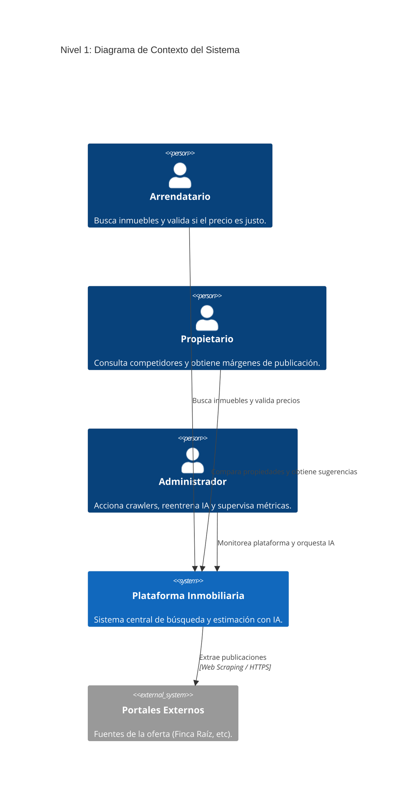
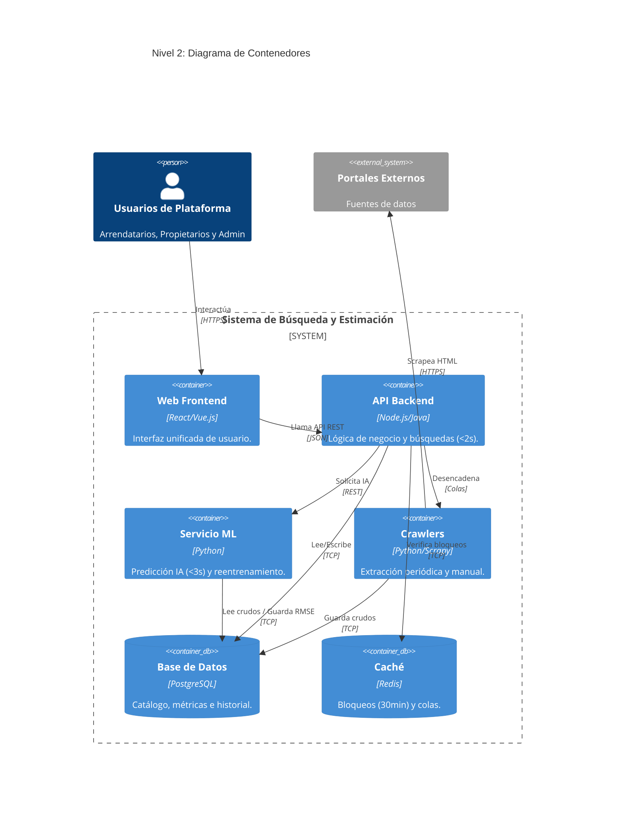
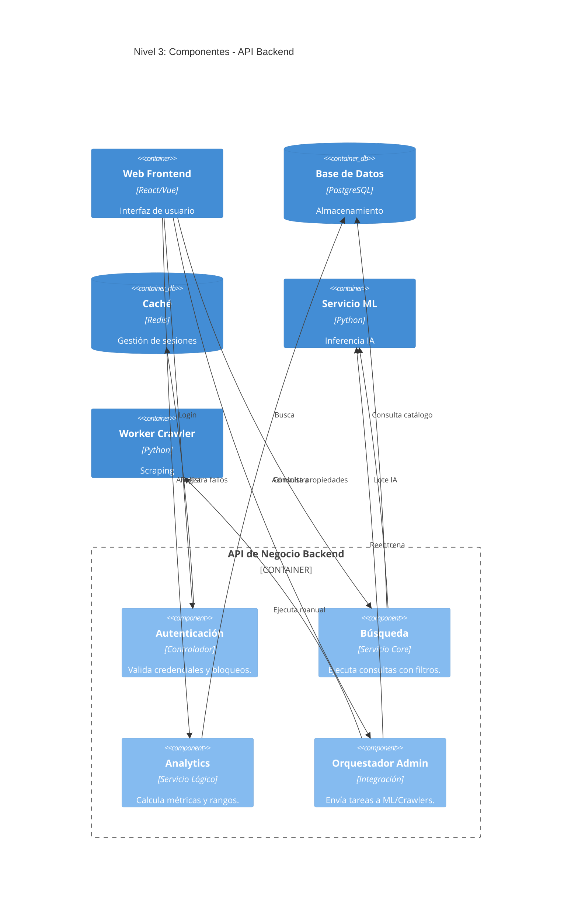
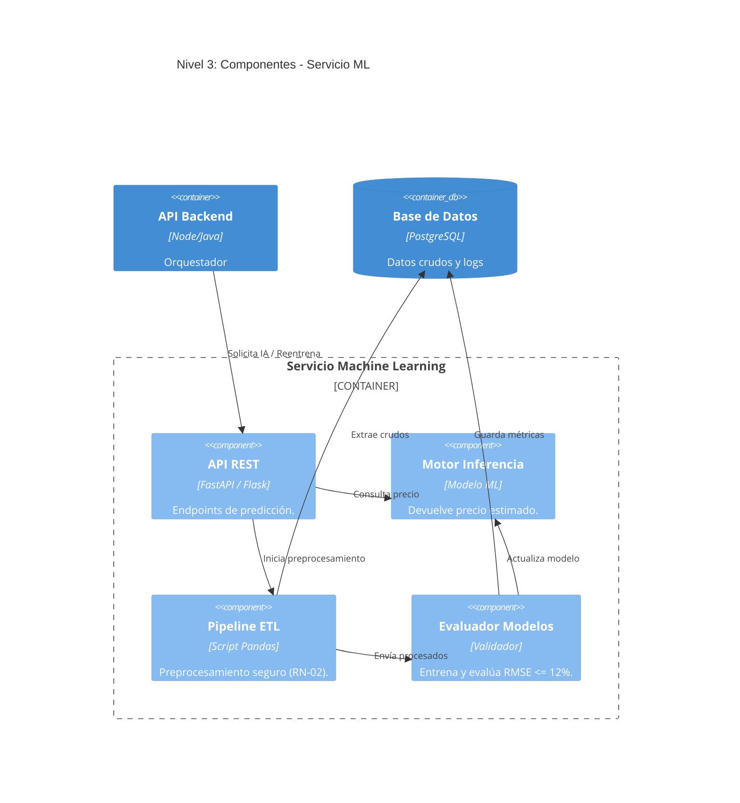
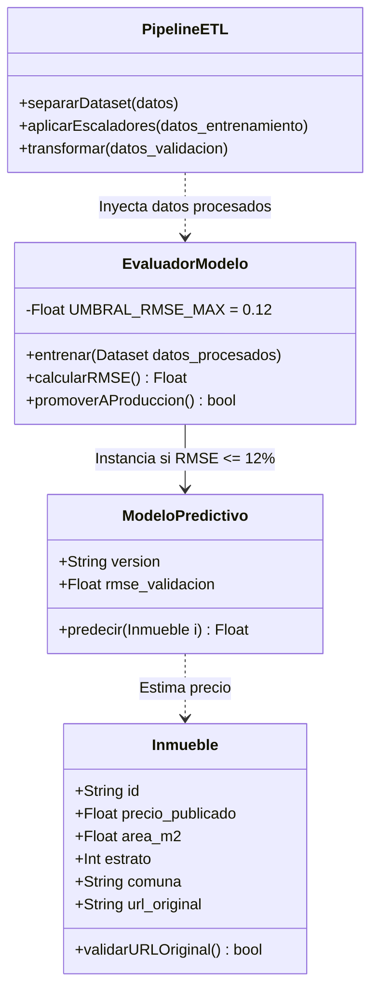

# Arquitectura del Sistema de Búsqueda y Estimación Inmobiliaria (Modelo C4)

Este documento detalla la arquitectura del sistema estructurada a través de las cuatro capas del Modelo C4. En lugar de ser un diagrama puramente técnico, ilustra cómo las reglas de negocio y los requisitos funcionales moldean el ecosistema, asegurando alta disponibilidad, calidad de datos y predicciones confiables.

---

## 1. Nivel 1: Contexto (El Ecosistema)

**Funcionamiento y Relaciones:**
En este nivel observamos el sistema como una "caja negra" que conecta tres perfiles de usuario con el mundo exterior. Los **Arrendatarios** y **Propietarios** acceden para consumir valor (búsquedas inteligentes, comparación y estimación de precios). El **Administrador** interactúa para orquestar la salud de la plataforma. A su vez, nuestro sistema se conecta hacia afuera consumiendo datos de los **Portales Inmobiliarios Externos**.

**El Porqué del Diseño (Decisiones de Negocio):**
Nuestra plataforma no es dueña del inventario inmobiliario; su núcleo de negocio es actuar como un **agregador inteligente** que combate la desinformación. Al separar los "Portales Externos" en el diseño, evidenciamos nuestra dependencia de fuentes de terceros, lo cual justifica estructuralmente por qué es vital contar con motores robustos de extracción de datos (Crawlers).

---

## 2. Nivel 2: Contenedores (Arquitectura Técnica de Alto Nivel)

**Funcionamiento y Relaciones:**
Abrimos la "caja negra" y separamos el sistema en unidades desplegables. El **Frontend** provee una única interfaz de usuario. El **Backend (API de Negocio)** centraliza la gestión de usuarios, el Analytics y las búsquedas, apoyándose en una **Base de Datos** y una **Caché (Redis)**. En paralelo, operan dos motores pesados: el **Servicio de Machine Learning (ML)** y el **Worker de Crawlers**, los cuales se comunican de forma asíncrona o bajo demanda con el Backend.

**El Porqué del Diseño (Desacoplamiento):**
*   **Aislamiento del Servicio ML y Crawlers:** El entrenamiento de IA y el Web Scraping consumen excesiva CPU y son propensos a caídas por bloqueos de red. Si compartieran el mismo servidor del Backend principal, cualquier reentrenamiento o fallo en el crawler tumbaría las búsquedas de los arrendatarios. Separarlos garantiza el requisito de responder consultas en menos de 2 segundos de forma ininterrumpida (*RNF-04* y *RNF-08*).
*   **Inclusión de Caché:** Los requisitos dictan inhabilitar temporalmente a un admin por 30 minutos tras tres intentos fallidos (*RN-05*). Redis maneja contadores con tiempo de expiración nativo de forma ultrarrápida, evitando sobrecargar la base de datos transaccional con bloqueos efímeros.

---

## 3. Nivel 3: Componentes (Los Engranajes Internos)

En este nivel observamos cómo se estructura internamente el código de los dos contenedores que sostienen la lógica central del negocio: el **Backend** y el **Servicio ML**.

### 3.1 Componentes de la API Backend

**Funcionamiento y Relaciones:**
Internamente, el Backend se divide en módulos especializados: Seguridad, Búsqueda, Analytics y Orquestación Admin. La búsqueda delega en ML la evaluación en lote para ordenar las "mejores ofertas", mientras que Analytics cruza datos de la BD para calcular los promedios del mercado.

**El Porqué del Diseño (Responsabilidad Única):**
Garantiza que la modificación de una regla de negocio no rompa otra. Si el día de mañana se cambia la fórmula para calcular el margen sugerido (+/- 5%) en el Controlador de Analytics, esto no afectará en absoluto el mecanismo de login de usuarios o la ejecución del orquestador de crawlers.

### 3.2 Componentes del Servicio Machine Learning

**Funcionamiento y Relaciones:**
Se descompone en un Pipeline de Preprocesamiento (ETL), un Evaluador de Modelos y el Motor de Inferencia (el modelo en producción que devuelve los precios). 

**El Porqué del Diseño (Control de Calidad de IA):**
El **Evaluador de Modelos** funciona como un estricto guardia de seguridad. Toma los datos del ETL y reentrena un modelo candidato; sin embargo, no lo pasa a producción (Inferencia) a menos que su margen de error (RMSE) sea inferior o igual al 12% (*RN-01*). Esta separación arquitectónica protege la plataforma impidiendo despliegues automatizados que puedan sugerir precios irracionales a los propietarios.

---

## 4. Nivel 4: Código (Detalle de Clases y Reglas Estrictas)

**Funcionamiento y Relaciones:**
Este es el nivel más profundo (estructurado habitualmente mediante diagramas de clases UML o flujos de código). Aquí ilustramos la estructura interna de las clases responsables de la integridad del sistema: la entidad física del `Inmueble` y el ciclo de vida seguro del `EvaluadorModelo`.

**El Porqué del Diseño (Integridad de Datos en Código):**
*   **Restricciones de Entidad:** La clase `Inmueble` requiere obligatoriamente el atributo `url_original`. El método `validarURLOriginal()` previene que el sistema procese propiedades inalcanzables (*RN-06*).
*   **Control de Despliegue en Código:** La clase `EvaluadorModelo` encapsula de forma privada el límite estricto de error (`UMBRAL_RMSE_MAX = 0.12`). Su método `promoverAProduccion()` evalúa esta condición matemáticamente antes de instanciar un nuevo `ModeloPredictivo`, lo que bloquea despliegues deficientes desde la propia lógica orientada a objetos (*RN-01*).

