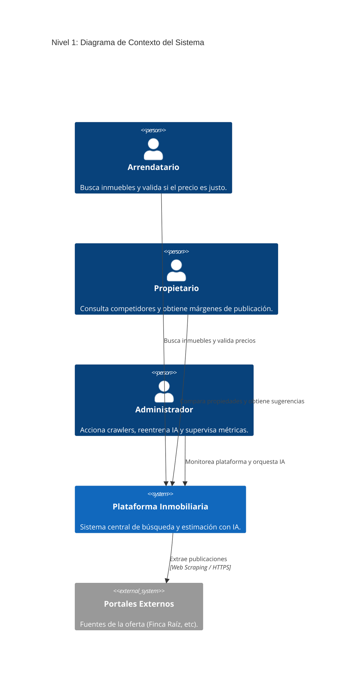
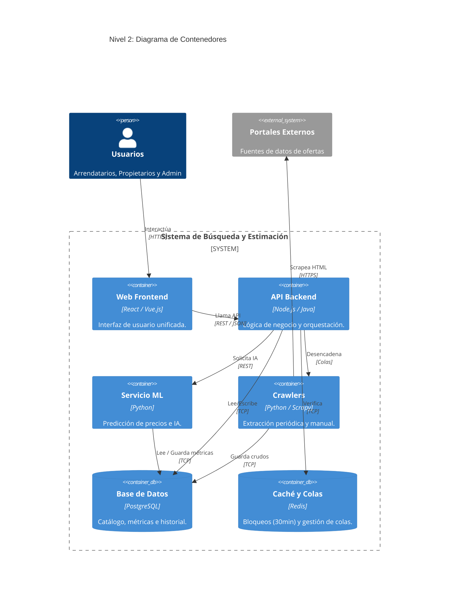
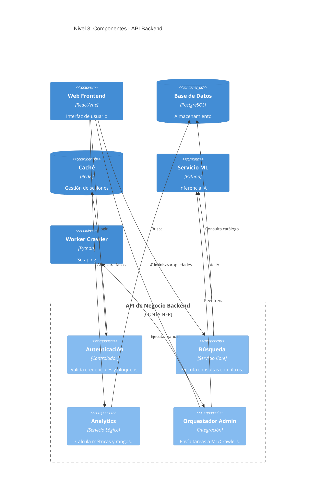
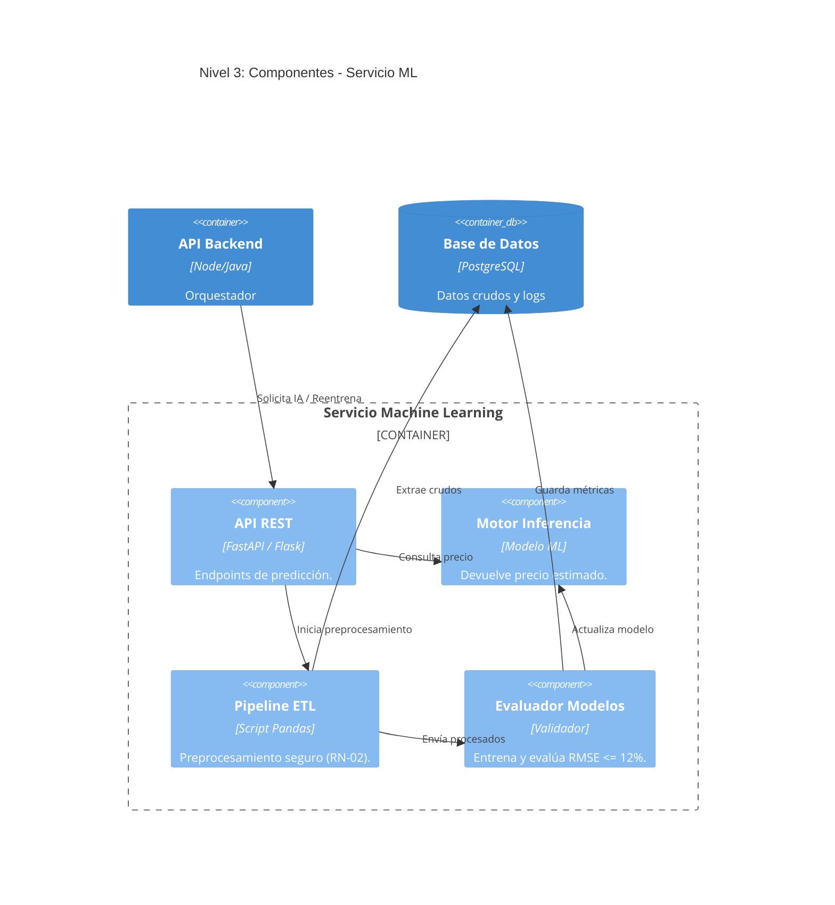

# Arquitectura del Sistema de Búsqueda y Estimación Inmobiliaria (Modelo C4)

Este documento detalla la arquitectura del sistema estructurada a través de las cuatro capas del Modelo C4. En lugar de ser un diagrama puramente técnico, ilustra cómo las reglas de negocio y los requisitos funcionales moldean el ecosistema, asegurando alta disponibilidad, calidad de datos y predicciones confiables.

---

## 1. Nivel 1: Contexto (El Ecosistema)

**Funcionamiento y Relaciones:**
En este nivel observamos el sistema como una "caja negra" que conecta tres perfiles de usuario con el mundo exterior. Los **Arrendatarios** y **Propietarios** acceden para consumir valor (búsquedas inteligentes, comparación y estimación de precios). El **Administrador** interactúa para orquestar la salud de la plataforma. A su vez, nuestro sistema se conecta hacia afuera consumiendo datos de los **Portales Inmobiliarios Externos**.

**El Porqué del Diseño (Decisiones de Negocio):**
Nuestra plataforma no es dueña del inventario inmobiliario; su núcleo de negocio es actuar como un **agregador inteligente** que combate la desinformación. Al separar los "Portales Externos" en el diseño, evidenciamos nuestra dependencia de fuentes de terceros, lo cual justifica estructuralmente por qué es vital contar con motores robustos de extracción de datos (Crawlers).

link a la herramienta: [Abrir diagrama en Mermaid Live Editor](https://www.mermaideditor.io/diagrams/flowchart#pako:eJx1VU1v00AQ_SsrwyFIoTRpKKUSh35QUQlQ1RRxiVSN1-N0Yb1rdtdtTcWP4ciBEzeu_WO8tRPXTkUutuftvDfzZuzcJdJmnOwnR7MjawLfhoUJKmgWH9U1azHZF8eKlo4KEhmL1RmLey3mygcuaGEW5oydt2ZEzrHJKJBTdiwWyUHveZHEyGHlJQlliopTzV7U4pq0ykh4JUBZOpbKCgBfKh_s1iJ51pGXzpaKO-6zh8eWGrX5SgcS0hYlB5VZ1wjYNCg2LIr7n26JGx8bKatUK0lS3f8xAxXKCmWa2uMNOnQEolbhQKI4AwFHNxrHx8Ixm4AeSZweQMpXJbtr5Qliv4KDgG_JF2ZeR7NGvvWsaUDDmNw6OHtqCpsqrdAMtVIrb4WM_KRjyen9X_-tYnhVw6CgirZ6tGug3uq0Kpdvb8OotC4QLG6kVvcCADtjfStyUoG99UOTsDnjlBidKIMRndP97-9jwUFuPVu1cM768nhjxr1-_jvadqi-YWk5BqPsURxhcuRiRsQzygYD9NWSoS0V9blWA-uxfLBGBQwfPA8Wg8bBPR_iqHrpXV7fL9jkqLckFlvTWvaZUzHH_EtlluKFeHdxcTZf2fOphCv8nmpbBexirpajp3I2v6KST825vXmzSKaRBMFDW8FCV6_jE1Ak48SHGgUk-3dJSp7jNVxxEd_O5nmMi_y6dDH5yGrrADyZ0CSd7gLL8WqeUKF0jbAn4597dioHUjrsiqu7lFdE0_xV1GPsTtaH0vQ1NRDWJKhB0k5GkoBoZbiLym1J-cvkB7hKDDlXsqm6LmPRubY38opcGLRm8L057PqIJNPZdG8nxaEGsi7jhns2me3t7q3CF_jq9ATHSQY5j8EMqXib8iangzu6PH_Nu7MetKbsHMRuuPDWZEPKrvEO7igfQY8osciSvd9gXPu_Rh8IN5A1X978EMfLZ2823V-F31PKeqg0yac7O8MDj4z0VYrPe3n1n8wOfjyXNXQR_y82eH_g9w8a-iv8)

---

## 2. Nivel 2: Contenedores (Arquitectura Técnica de Alto Nivel)

**Funcionamiento y Relaciones:**
Abrimos la "caja negra" y separamos el sistema en unidades desplegables. El **Frontend** provee una única interfaz de usuario. El **Backend (API de Negocio)** centraliza la gestión de usuarios, el Analytics y las búsquedas, apoyándose en una **Base de Datos** y una **Caché (Redis)**. En paralelo, operan dos motores pesados: el **Servicio de Machine Learning (ML)** y el **Worker de Crawlers**, los cuales se comunican de forma asíncrona o bajo demanda con el Backend.

**El Porqué del Diseño (Desacoplamiento):**
*   **Aislamiento del Servicio ML y Crawlers:** El entrenamiento de IA y el Web Scraping consumen excesiva CPU y son propensos a caídas por bloqueos de red. Si compartieran el mismo servidor del Backend principal, cualquier reentrenamiento o fallo en el crawler tumbaría las búsquedas de los arrendatarios. Separarlos garantiza el requisito de responder consultas en menos de 2 segundos de forma ininterrumpida (*RNF-04* y *RNF-08*).
*   **Inclusión de Caché:** Los requisitos dictan inhabilitar temporalmente a un admin por 30 minutos tras tres intentos fallidos (*RN-05*). Redis maneja contadores con tiempo de expiración nativo de forma ultrarrápida, evitando sobrecargar la base de datos transaccional con bloqueos efímeros.

link a la herramienta: [Abrir diagrama en Mermaid Live Editor](https://www.mermaideditor.io/diagrams/flowchart#pako:eJx1VUtz2zYQ_isYtgd5Rk2sRx3HMz1YDzfuqI5qKelFM5kluJTQkAALgHYYj39Mjznnlqv-WBcASYtywgvJfXz77e5H8CHiKsHoIpqOp0paEBL1RlphM2Q34g4zNrxgMwFbDTmwBJmLQomJ0mg2ciOXqI2SvdKg7rNN9M6UoIUym8i9XWqNMgHrTX221KoQGN5YxS6TXMhNdOJgVpWxmH-YqJLiddXjA5e_Es7q607238y_JSZAiXNjRQ5c7L-6dPawkYyuln_PFOCy_8aYXWnPNwl8bhG4ZS_Z-xJf_FNzvCa_TuGzK1IG9qyUIhUcEnjh6XXRoRC-t-U1mwD_2ILf0CAJleD_gDsItsX-65aAHLbEreKEXTGlqRFjQwPfq5BnvnnUd8Jl_LkIYMvK7pSsnzUmgnsEB15o5G6oyK4vnxCPcbmG-yzsaRoezSEyMV9RSFEF4_yT1VCXKFDTPXGtVCwHWUL2HeKzuJfELnUCBh2tGdhGCktl7Fbj6q-6mSnY_X-Z2qo-y_dfrCZoR39HG1da_AieA99hSOe7_RciM1UZmGa7iagfJ5miGdNAeqNTEtkJBW5p5M24uEsKFR4P1Ecd9wqlLWRoAufwzMiBWjatXJVImjEOKHENugeVIsWaWs23mH2Y1d9ELUYvM1Lf_lstjTfr9XLl40O0j6u1tcjc10YKqxubr9ZOVqu3NwcFboMSa7GojLRigfb_lHOA7kMP9j9Dg5IUjrKmU8_xpIPdjvs97d99ESF2PV0eQ4e9LxBfzg3XIsZuZBPbMjgcsxcdAnuzbpR-PJs2LZT5nb5SOgi4LpNmJ11KbiYtI5pcndAK7Zjcu4IWiQuoVGlJbqnY9n7m49WOaF3LW3X_2yYauRwyNidUYx8QRNSPjK2om-jiIYpJ--5ud5i7g9W_9-nGP261S6ZJK02OnwYwiIdn5EtJ4VeQi6wiswFpfjFu3uQpNB10umpTXgEM01euHnLlebSuOH4N3kU6s6KTNEqAA3ky-opaKz_lkP4aPRJWQYcHbdezrgpHOs3UPd-Btp3WJJ1wk7YPBzIcD89HMQV5l9IJeuzxYHx-dl6b1_jJHhTsRwmVM0LJLhSeQupzWncLl6av8Wx84Gog2wnSaartXCZdyLbx1t1CPnM9gyy04mjMEWIz_8b7BHjkafBSf5EdtFb3x9OvzQuIMetWGqTD0agb8GyQpozpv1zsfpDZup_vpXGt3Y_-CPeRrv8B8myqFQ)

---

## 3. Nivel 3: Componentes (Los Engranajes Internos)

En este nivel observamos cómo se estructura internamente el código de los dos contenedores que sostienen la lógica central del negocio: el **Backend** y el **Servicio ML**.

### 3.1 Componentes de la API Backend

**Funcionamiento y Relaciones:**
Internamente, el Backend se divide en módulos especializados: Seguridad, Búsqueda, Analytics y Orquestación Admin. La búsqueda delega en ML la evaluación en lote para ordenar las "mejores ofertas", mientras que Analytics cruza datos de la BD para calcular los promedios del mercado.

**El Porqué del Diseño (Responsabilidad Única):**
Garantiza que la modificación de una regla de negocio no rompa otra. Si el día de mañana se cambia la fórmula para calcular el margen sugerido (+/- 5%) en el Controlador de Analytics, esto no afectará en absoluto el mecanismo de login de usuarios o la ejecución del orquestador de crawlers.

link a la herramienta: [Abrir diagrama en Mermaid Live Editor](https://www.mermaideditor.io/diagrams/flowchart#pako:eJx1VU1z2zYQ_SsYtgd5xmmijzqOZ3qwZKfjGSV15DS9aMazBJYUahBgAdCu4vGP6TGHnHLrVX-sC_AjpFTzInHf7tu3u1jwMeFGYHKWLGYLU5RGo_Zr7aVXyN7Le1RsesY6BB17wc6vr9gc-B1qsdZrvTDag9RoR66EY7ZO_sCUvbVkDQ5JsKwQuH_5qcL69Yogm8FnJpBVrgIrzTo56jFdpCORBs85OAxeF-CNq4OvjfO5xZsPy_r9XBXAUUMhSd8hDwe-weC3oD-7L60eIRu6X9F5ufumQxaHTlKZbkgyKlRwvEF7L7k07F2T-HrrN0a3FWVoUXMJ7Op8L5xbeFBoY2eMvUPLFrXlkOaGfEup88jQ47idm0oLsNsRwbFoGgEJfo-5CZLaaSRH7HGtGT3dxEZQ-U0MqWgeXlI_Qrl1vpDAGgXCNGI-gZICGLcoYjWKBr5lqTJ_VWjcT1HXkN4hWB4TzHf_OnIT0NTS9mthbDP3yz-RV57ojXaV8uDCP5ZJRSL-lxw0qC1pdrGA9mWPf7n7lktumopA8UoBK3ZfvKVig3wLOn-GXxRS35qmgN8syXc-dIOdB-T7ac1tv22X-n73FZgHi5QA6ES8bEbaZHkK01uhur2od6KdwdLkgfVoAPY6WDkO-_BBD-TnQ59BHVG7dN5Cc45qz1pEtw8rzKMPy0Ap4_qUjaB6BRfNsCjS7_5RJjc91564Pe_SmlLSYRDYp-4LrddqhTQIWh14xqu3Pe3xKUBXoDr_VSe4Zlwaj-0WrvXvpQCPS9iaypO4TOajH_nsZgMlXumVefhlnczCVMnYLllrHxNFcpw4v6U1SM4ek5Ruo_DrN1iEKzO-H9MPv8ttCF4YZSwBP4xhnE5OCMtow97S3aS2ZHag3QuHVmaElFYWlKwLeQ0wyV6HfEhbIfpQmr6BCNG16eUgaCqAAyGKronOyl9xyH5OnoirRC4zyaPqbRlEZ8o88A1YPyhN00dg3tURSCazyek0JacIGSswcs_Gs9OT08b8Ef_2vYTHiaB04Q4dUuEryGJMB3d0WfYGT2Y9qKXsOkgLaf2lFkPKrvAO7igPoANKOpscndtjbPvfot8J95CWL4sP2cFa87Df_ca8hBTVMNM4m0ynQ4eDRroqpTun3DwT2cGHc2mhj-ETvsf7RM9_78aqWA)

### 3.2 Componentes del Servicio Machine Learning

**Funcionamiento y Relaciones:**
Se descompone en un Pipeline de Preprocesamiento (ETL), un Evaluador de Modelos y el Motor de Inferencia (el modelo en producción que devuelve los precios). 

**El Porqué del Diseño (Control de Calidad de IA):**
El **Evaluador de Modelos** funciona como un estricto guardia de seguridad. Toma los datos del ETL y reentrena un modelo candidato; sin embargo, no lo pasa a producción (Inferencia) a menos que su margen de error (RMSE) sea inferior o igual al 16% (*RN-01*). Esta separación arquitectónica protege la plataforma impidiendo despliegues automatizados que puedan sugerir precios irracionales a los propietarios.

link a la herramienta: [Abrir diagrama en Mermaid Live Editor](https://www.mermaideditor.io/#pako:eJx1Vctu2zAQ_BVCRYEESJr40bzQHuJHihRxmtpuTwaCFbWyidCkSlJO3CAf1ENPvfXqH-uSkuXISXURuLMzuztL2Y8R1wlGZ1G33dXzTCtUbqKccBLZtVigZK0zViFo2T4boVkILjQbXE3URHW1ciAUmh3IxB6bROc3l6wD_A5VMol84JoqHHyGBRTHL-ZHjtZBos0k2q1J3HZ0rhIwy5259KmbUsBnlMCuEIwSakpE9jhRjJ6qOV__tuD5Fob90bgoeAHW-cgBu5Bg74pgXyWZFspZliDLDCaCc7H6o96FnurCQqVoUHH0xIF22rDLMiTKoQY0owyWhGMPFznKRVD2_dO8Yk4Tv6aOLvR8IzKUfsb-uBQZcSMyx26ALLFF6MZgZjRHC3NBXM0sTnOj2c7wev-wufuq_AJkDtRzmDocyHlWNFzKfgcpkmIhhTeOZgO2ZJ68-gtsOBj12YePrNF8W9R4qu2tF-8ksWd2wKI3tEcF1y1r66YGR1_X1niIcZMn9Foyqae2vAZDlLe94hZtVjnSkm6AA3Z5TgscIha9BUpFCLm1LVFrNpdEKxbwSnpp-6Ui-ZBWM7bWUkgtBuw_OANYtv9MNaTUrVaL1W8vHFS3sjeJheynHEwCbL765YzgsMn99jy3NuE5dzmt7SexwiqJEu1F1i0l2ujsMYppFf7tZjj3H3g479GL302N_8y6WmpDwJsGNOLmEWEp7fOCDJBLCltQdt-iESkhmaHra5YV5RigmR77esh1-GIrKI5PIUAOjRM1UisBDoT4a15F-SGH9H30RFoZrSoVPHS9zHzTqdT3fAbG1UZTNHCnmsOLNNvNk1ZMSQHSJsGg3W60T45OyvAYH9yzgntRQuWs0KouhYeQBk4FV3JpeopH7WfQWrJykH7WjKOflrpkNXgFV5IvoBeSxQWyW4pr_9foRnALWeul4aE4GKPvt90vw1cQo6xXaqTNVque8MJIm8dTA9nsP8wKfrmXNTT2fzhbuk_0_AM_ETHB)

---

## 4. Nivel 4: Código y Diseño Detallado (Diagrama de Clases con Estereotipos BCE)

**Funcionamiento y Relaciones:**  
Este nivel representa la vista más granular de la arquitectura de software. Para el diseño detallado del sistema, se adopta el estándar de modelado con **estereotipos de Análisis y Diseño BCE (Boundary - Control - Entity)** extendido con la capa de **Service**. Esta separación garantiza una alta cohesión y bajo acoplamiento entre la interfaz gráfica, la lógica de negocio y las entidades de datos del ecosistema inmobiliario.

A continuación, se presenta el diagrama de diseño formal que gobierna la implementación técnica de las clases y componentes en el sistema:

link a la herramienta: [Abrir diagrama en Miro](https://miro.com/app/board/uXjVHp2Fodw=/?focusWidget=3458764683025935131)

---

### Explicación Arquitectónica del Diagrama de Diseño

El diagrama organiza los componentes en cuatro categorías estereotipadas claramente delimitadas:

#### 1. Capa de Presentación e Interfaces (`<<boundary>>`)
Representa los puntos de contacto entre los usuarios y el sistema, capturando eventos y mostrando resultados:
*   **`CalculadoraPrecioUI`:** Permite a los usuarios ingresar las características de una vivienda (`solicitarEstimacion`) y visualizar el valor monetario estimado devuelto por el modelo predictivo.
*   **`LoginAdminUI`:** Interfaz exclusiva de autenticación para el administrador. Envía credenciales y recibe el estado de la cuenta, informando los minutos restantes de inhabilitación en caso de bloqueo (`mostrarBloqueo`).
*   **`CatalogoUI`:** Vista unificada de inmuebles para arrendatarios. Permite consultar el catálogo consolidado, aplicar filtros avanzados de búsqueda y ordenar los resultados por el indicador de "Mejor Oferta" (*RF-01, RF-02*).
*   **`PanelPropietarioUI`:** Interfaz de análisis de mercado para propietarios. Muestra el listado de propiedades competidoras similares (*RF-04*), las métricas estadísticas agregadas (*RF-05*) y el rango comercial sugerido para publicación (*RF-06*).
*   **`PanelAdminUI`:** Consola de administración centralizada. Permite accionar manualmente los crawlers de extracción (*RF-08*), iniciar el reentrenamiento de modelos (*RF-10*) y visualizar las métricas del sistema (*RF-11*).

#### 2. Capa de Lógica de Aplicación y Orquestación (`<<control>>`)
Controladores especializados que orquestan las operaciones del sistema y hacen cumplir las reglas de negocio:
*   **`EstimacionControl`:** Recibe los atributos de la propiedad y coordina la llamada al servicio de inferencia predictiva (*RF-03*).
*   **`AutenticacionControl`:** Valida credenciales contra la entidad `Administrador`, registra intentos fallidos consecutivos y ejecuta el bloqueo temporal por 30 minutos tras registrar 3 intentos erróneos (*RN-05, RNF-01*).
*   **`BusquedaControl`:** Procesa los filtros de búsqueda sobre el inventario y calcula el índice de "Mejor Oferta" comparando el precio publicado contra la estimación del modelo predictivo (*RF-02*).
*   **`AnalisisCompetitivoControl`:** Ejecuta la búsqueda de propiedades similares invocando la regla de comparabilidad sobre la entidad `Inmueble` (*RN-03*), calcula las `MetricasCompetitivas` del sector (*RF-05*) y genera el `RangoPublicacion` (*RF-06, RN-04*).
*   **`CrawlerOrquestadorControl`:** Administra la ejecución programada o manual de los crawlers hacia cada `Portal` configurado (*RF-08, RNF-03, RNF-07*), gestiona el ciclo de vida de `CrawlerJob`, extrae entidades `Inmueble` y genera registros en `LogAuditoria` (*RNF-09*).
*   **`PreprocesamientoControl`:** Limpia los datos recién extraídos descartando registros sin URL (*RN-06*), codifica variables categóricas y escala variables numéricas exclusivamente sobre el conjunto de entrenamiento para prohibir la fuga de datos (*RF-09, RN-02*).
*   **`ReentrenamientoControl`:** Entrena el modelo predictivo con el dataset preprocesado, evalúa la compuerta de aceptación por margen de error RMSE $\le 12\%$ (*RN-01, RNF-02*) y promueve el modelo a producción actualizando `ModeloPrediccion` (*RF-10*).
*   **`DashboardControl`:** Extrae las métricas históricas de RMSE de `ModeloPrediccion` y el histórico de ejecuciones de `CrawlerJob` para alimentar las gráficas del administrador (*RF-11*).

#### 3. Capa de Servicios de Inferencia (`<<service>>`)
Servicios desacoplados que aíslan la complejidad técnica especializada:
*   **`ModeloPredictivoService`:** Encapsula la carga del modelo predictivo en memoria y ejecuta la inferencia matemática (`predecir`) en tiempo real respondiendo en menos de 3 segundos (*RNF-05*).

#### 4. Capa de Dominio y Persistencia (`<<entity>>`)
Representa los datos del negocio y sus comportamientos intrínsecos:
*   **`Inmueble`:** Entidad central del catálogo que contiene los atributos físicos (`area`, `estrato`, `comuna`, `tipoInmueble`, `habitaciones`, `banos`, `parqueaderos`), el enlace obligatorio `urlOriginal` (*RN-06*) y el método de negocio **`esComparableCon(otro: Inmueble): boolean`**, el cual valida estrictamente los cuatro criterios de similitud de **RN-03** (misma comuna, mismo estrato, mismo tipo de inmueble y variación máxima de $\pm 15\%$ en área construida).
*   **`RangoPublicacion`:** Objeto de valor que modela el límite inferior (-5% para liquidez rápida) y el límite superior (+5% para máxima rentabilidad) sobre la estimación base (*RN-04*).
*   **`MetricasCompetitivas`:** Entidad que agrupa las estadísticas de mercado calculadas sobre los competidores: `precioMinimo`, `precioPromedio` y `precioMaximo` (*RF-05*).
*   **`Portal`:** Configuración de portales externos soportados (`nombre`, `urlBase`, `activo`), habilitando la incorporación de nuevas fuentes sin modificar el orquestador (*RNF-07*).
*   **`CrawlerJob`:** Registro de trazabilidad y auditoría de extracciones (`fechaInicio`, `fechaFin`, `registrosExtraidos`, `estado`, `resultado`).
*   **`ModeloPrediccion`:** Historial y estado de las versiones del algoritmo predictivo, almacenando su margen de error `rmse` y la bandera booleana `enProduccion` (*RN-01*).
*   **`Administrador`:** Entidad de seguridad que encapsula `passwordHash`, contador de `intentosFallidos`, fecha `bloqueadoHasta` y la consulta `estaBloqueado()` (*RN-05*).
*   **`LogAuditoria`:** Registro inmutable de trazabilidad para cada acción sensible de extracción o reentrenamiento (*RNF-09*).

---