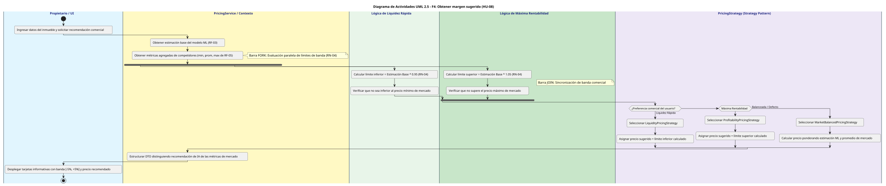
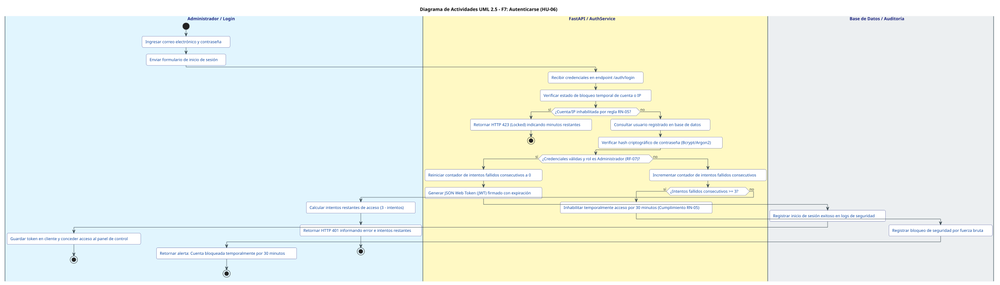

# 5. Diagramas de Actividades del MVP (UML 2.5)

**Proyecto:** Sistema de Búsqueda y Estimación Inmobiliaria (Medellín)  
**Estudiante:** Heman Santiago Bermudez Espinosa  
**Docente:** Alexandra Guerrero Bocanegra  
**Asignatura:** Diseño de Sistemas de Información — Instituto Tecnológico Metropolitano (ITM)  

---

## Tabla de Contenido de Funcionalidades del MVP

| ID | Funcionalidad del MVP | Prioridad | Momentos Concurrentes / Paralelos | Historia de Usuario |
| :-: | :--- | :--- | :--- | :--- |
| **F1** | [Orquestar extracción de datos](#f1-orquestar-extracción-de-datos) | **Alta** | **Fork/Join:** Scraping asíncrono concurrente multi-portal | HU-03 (RU-03) |
| **F2** | [Preparar los datos](#f2-preparar-los-datos) | **Alta** | **Fork/Join:** Pipeline paralelo de variables numéricas y categóricas | HU-04 (RU-03) |
| **F3** | [Reentrenar el modelo](#f3-reentrenar-el-modelo) | **Alta** | **Fork:** Tarea pesada en segundo plano vs servicio web activo (**RNF-08**) | HU-05 (RU-03) |
| **F4** | [Obtener margen sugerido](#f4-obtener-margen-sugerido) | **Alta** | **Fork/Join:** Evaluación simultánea de banda de liquidez y rentabilidad | HU-08 (RU-02) |
| **F5** | [Consolidar catálogo](#f5-consolidar-catálogo) | Media | Interacción asíncrona SPA sin recarga (**RNF-06**) y redirección | HU-01 (RU-01) |
| **F6** | [Estimar precio de una vivienda](#f6-estimar-precio-de-una-vivienda) | Media | **Fork/Join:** Inferencia ML concurrente con consulta SQL de competidores | HU-02 (RU-02) |
| **F7** | [Autenticarse](#f7-autenticarse) | Media | Validación secuencial de intentos y bloqueo temporal (**RN-05**) | HU-06 (RU-03) |

---

## F1: Orquestar extracción de datos

- **Historia de Usuario:** **HU-03** — *Como administrador, quiero accionar los crawlers manual o automáticamente, con visibilidad del estado en tiempo real, para mantener actualizada la oferta inmobiliaria.*
- **Requisitos vinculados:** RF-08, RNF-03, RNF-07, RNF-09.
- **Tipo de concurrencia:** **Paralelismo de Red (Fork/Join)** en la extracción concurrente hacia múltiples portales externos configurados.

### Diagrama de Actividades Renderizado (SVG)

Link a la herramienta: [PlantUML](https://uml.planttext.com/plantuml/svg/hLRTRXf75Bv7uXsEaWj0gXFpRwzLDNXX5Th6ZeojNaR3p04ctfqXixEckFHX-W2-oWDKAY_MCxCB0PgGICrA2EsUET_vpiztTb-bbXcR9N6vPAMD4VgIJGrB60Y47hVoGGecC8MxDxz2uqKRJY2g1t1jFcJeN05_juPnBjSVbNCHpEeKgg_lJawRjNAfN4hlfPepGYJhX6MnZRIoLon1U3R2gKQu6pxRFMLqfWJNHg61irr3EcD2BwIQmeJ5AUwP5ZA9cKBuerm2kYwr4MX27Mi3prljTg_JsZNSpYI_LvYcK7_HpWstBdV7h72gznhDxk30DfAF2FNcuLExfBADTIpAfJztMJ5VFRlSicByVkhJAu94_leCvTteEwHE-wrkh_xfSSwdSHZM6BtOn2myczrMjnNz1x3HQJQQPuU0TGzOBgsU3-fHEngiUYAHIgRKPq5UBs74PoYo6CtA7Q8KpiFMAcAfxRqTaZaqR4764Pe7oT6V6VG7tQYpAYmHLKQR9LHlhgAJqsujFt8MjGVdgz-qkQVElq5hDC-OS36zFJmRTCAjFPAACxXXwwT7R-sr-vrUTsCD9Ie8lNUQWuU3AAglBbcARaZxVaXVGYyJafYidrZ1vTnn8OTZ6Nl1b4l1ICUIoqC994nbB0ODSwEzZiG6kna0TtUDrgnsuQCSALaG6YHaWrF7GWFbSzc72i_FlNklnsa5gaw1GiEFK1aemFV8Cq-Yul23KAkKv4OeSsqiYqd3VY8fSqBZMataD2FUdlQc5JcnB_T9Jg3wpzzlDu2fzjZ2OO9KH2TsDp_LmCueI5NfMZvTnt9rze1M3TLDFXBT8rdIQ9lA3rGMdrd-CDpFHAg7zLynBIrV1OUTMZqlbv1s1bJJzLF1A1WwkefBYbW4J2518Pco29lKQGvdMX0GAY4dN-kQqkHgv7Hc0nWgcWxjfkrJOy0fDCQOGKByvKdU6AXUacOPHDStln2v2SrmKRGlYC7J7pXKtrsqBf9o_KsNYhlMmWWJDfzfWqKDWXlaEaRk76B7Shkgzy0lyl30faogVHBxYlkk57QWZn0u4FLtPR2BdJSRyZRiTZJlqi_Nmwi0HaJPQ4NpkdtpMUra4FkVnVHhiv8hwNKsrkvzvjmuitJSh3zE9ATRWZGejbBQcToGpItDkriy7ET5silDil39JVtWERbS_5-14U8Z-voMjk8ExfGapguDsPYM8YieSPC9vhTDWeasacsut6fRK7dGSPQWhvzKIOPZjrNyFbq_KJaBXszStD-U9qsSFoCq9Jj1FcFl9bAHHUd5GQgvxb_HFtqa_Gi0)

### Identificación de Piscinas (*Pools / Swimlanes*) en el Diagrama

| Piscina (*Pool*) | Rol / Capa Arquitectónica | Responsabilidad dentro del Flujo | Color Distintivo |
| :--- | :--- | :--- | :--- |
| **👤 Administrador / Scheduler** | Interacción & Disparador Temporal | Inicia la extracción de forma manual o programada cada 24 horas (RNF-03). | `#E1F5FE` (Azul hielo) |
| **⚙️ FastAPI / CrawlerService** | Control de Aplicación | Registra la auditoría del job, coordina la factoría y consolida en memoria. | `#FFF9C4` (Ámbar suave) |
| **🏭 CrawlerFactory (RNF-07)** | Patrón Creacional GoF | Instancia dinámicamente los scrapers configurados sin acoplamiento. | `#EDE7F6` (Lavanda) |
| **🕷️ Worker Metrocuadrado** | Worker Asíncrono de Extracción | Ejecuta peticiones HTTP asíncronas con limitador semafórico en Metrocuadrado. | `#E8F5E9` (Menta claro) |
| **🕷️ Worker Finca Raíz** | Worker Asíncrono de Extracción | Ejecuta peticiones HTTP asíncronas con limitador semafórico en Finca Raíz. | `#C8E6C9` (Verde claro) |
| **🕷️ Worker Cien Cuadras** | Worker Asíncrono de Extracción | Ejecuta peticiones HTTP asíncronas con limitador semafórico en Cien Cuadras. | `#A5D6A7` (Verde medio) |
| **💾 Base de Datos / Auditoría (RNF-09)** | Capa de Persistencia | Almacena y actualiza el estado, total de registros y marcas temporales del job. | `#ECEFF1` (Gris platino) |

### Explicación breve del flujo
El orquestador recibe la orden de extracción diaria (**RNF-03**). Resuelve dinámicamente las clases mediante `CrawlerFactory` cumpliendo **RNF-07**. Al iniciar el scraping, una **barra Fork** abre tres flujos paralelos concurrentes hacia Metrocuadrado, Finca Raíz y Cien Cuadras con control de concurrencia no invasivo. Una vez finalizadas las peticiones, una **barra Join** sincroniza los flujos, totaliza los registros en memoria y actualiza la auditoría del job (**RNF-09**).

---

## F2: Preparar los datos

- **Historia de Usuario:** **HU-04** — *Como administrador, quiero que el sistema limpie, codifique y escale los datos automáticamente antes del reentrenamiento, para asegurar la calidad del dataset sin fuga de datos.*
- **Requisitos vinculados:** RF-09, RN-02, RN-06.
- **Tipo de concurrencia:** **Paralelismo de Procesamiento (Fork/Join)** en la transformación independiente de variables numéricas y categóricas.

### Diagrama de Actividades Renderizado (SVG)

Link a la herramienta: [PlantUML](https://uml.planttext.com/plantuml/svg/dLPDRnit4BqBq7yO92WW0tPWoPBjo8T6bNSHjVwgPHUv1QCbjMBD9RSaruPJvSVuc4CEXM-z5EZ-iGwvAsNz0RUe3fQyd7dptimRIk-iG-EAJBPRJZZ9uL1WQZ13O1n6YHFNWY7Z5YwFZw3tPW1R4FU6S6PuZWODI6s1eQE_dVUNMzlzZNQhtR9NGldZZ43cM4WNQ-LECEFmQifJpU5oygePPNIXMAADuWRscmTsWKpV29N27ANb3uvkH2PHSVYztG9w_Q0DusQifJRmkZyOZ7RxpOEBXKYk5BSMkcy6rS65r-kPrKdTKMzdBtfqDXMVE7Ht7ZzrjzIgcPQitVhSP8MXO-vspGgJgpJ8gul4uVKCvMRr1gdjm_xUgFljSSMdzxYiCVfcLRFEtDdhx_NZ9u2ztPtUplvZm6u0RBUMhwDkF8YZvKIbdApXNN3enxlqPyJyxRY_Z8LqHlkZCKfl3-YSdsnjxsw4eEWmsejtboDX9MQ2AwVXc3lDj2plKv7eAhXN1-_7W-ZjyapaN0eQvacHbLzCYBemA5GLDTwFTiUDg34wdfRtJ-AYSHJ7tMMaB6OpITRn78_HKI0v-5jTYdr6NzY4TcjupXCn4mRoOYP5WedGv1j8JC7G0bUGyKmRWGS1vwLUt2m4kQJpzry_5voX0iDJOIcw0gEtd0QI6qtaq7o_0O8uslBhHZMSuKJPd2U-FEtPAlUWEXHpZtkcBQTbEZy28fGAXHAK1bL893It8AuTfMku07d8RK8Y6tZG6HTPBaKzgOfxNOJJoZKP1OWHmzm3873xMy7feaXGbVVAp-BCw9mRTpisd2PqqCnAgM38ag9gUruOPBYgf9YOjrlqLlSiqARs_XSN3Sz8agZxH7SHMkvM1IXkV_ix21xPX1vz_2MCoL7qHfYWqeu3TM_XXhIjnY34f-S_LJTSDPgwlDyqoMMOzJMI0MQIstPhhirL9U9b5uSsJBbSJtIDGGEhmibUdVAEUhS92vm9Lrjl4sPO_g7jQYn3Sbf2CpRaH2OGRecHlHOKJMEWgRZoJZ4wfKy4wkZQLIIHp12uh43e7sM9V4QHYPP5fl0Xawb33yEc2SaslhYN2fWIo6F1po_a2vAJTO8lbUYiKAJQCwPbt0GdShsMEs4aGCmfr5HvsfHVAQtyKuNq_w7pOVbJnTzh5wb4iqee-H2gkJvrnu-davCXJ8LAZ5RYKztrMy9M7bLL3u9v__KU6evNIJJBrR7XbhunaRJOu3ceoN_uwBmkcFiz9v8Fb7tuU4tBNpWXYPAYWlvxcRBBkuo76oStFAbiuoyUehDgKbCXxU-2hZvANqUR1oXMpuntlr-XIdY7Ek5lK8GZZbUOSjfRcZdDsJCnuDOacIPbWByMjFzCrzfenLYH1AW3VmFhlDrwH-sd7oJ_0000)

### Identificación de Piscinas (*Pools / Swimlanes*) en el Diagrama

| Piscina (*Pool*) | Rol / Capa Arquitectónica | Responsabilidad dentro del Flujo | Color Distintivo |
| :--- | :--- | :--- | :--- |
| **📥 Ingesta de Datos** | Memoria / Buffer de Entrada | Recibe las publicaciones crudas extraídas por los crawlers. | `#E1F5FE` (Azul hielo) |
| **🧹 Filtro de Calidad (RN-06)** | Regla de Negocio & Limpieza | Valida que cada inmueble posea URL canónica; descarta registros incompletos. | `#FFF9C4` (Ámbar suave) |
| **📐 Aislamiento Metodológico (RN-02)** | Metodología de ML | Realiza el split 80% Train / 20% Val aislando parámetros estadísticos. | `#EDE7F6` (Lavanda) |
| **⚡ Pipeline Numérico (Train)** | Rama Concurrente Numérica | Calcula media y desviación estándar para ajustar y transformar con *StandardScaler*. | `#E8F5E9` (Menta claro) |
| **⚡ Pipeline Categórico (Train)** | Rama Concurrente Categórica | Extrae categorías únicas de Train para ajustar y transformar con *OneHotEncoder*. | `#C8E6C9` (Verde claro) |
| **📦 Ensamblado de Matrices (RN-02)** | Validación & Serialización | Concatena $X_{train}$, aplica transformadores congelados sobre $X_{val}$ y guarda artefactos. | `#ECEFF1` (Gris platino) |

### Explicación breve del flujo
El pipeline depura los datos aplicando **RN-06** (descarte estricto de inmuebles sin enlace original). Tras dividir el conjunto 80/20, se abre una **barra Fork** que ejecuta en paralelo el preprocesamiento de columnas numéricas (escalado) y columnas categóricas (codificación One-Hot). Ambas ramas confluyen en un **Join** que concatena la matriz `X_train`. Siguiendo **RN-02**, los mismos transformadores se aplican a `X_val` sin recalcular estadísticas, impidiendo la fuga de datos (*data leakage*).

---

## F3: Reentrenar el modelo

- **Historia de Usuario:** **HU-05** — *Como administrador, quiero desencadenar el reentrenamiento y que el modelo solo se actualice en producción si supera el umbral de error, para no degradar el servicio.*
- **Requisitos vinculados:** RF-10, RN-01, RNF-02, RNF-08.
- **Tipo de concurrencia:** **Desacoplamiento Asincrónico (Fork)** entre el servicio web HTTP y la tarea en segundo plano (*Background Task*).

### Diagrama de Actividades Renderizado (SVG)

Link a la herramienta: [PlantUML](https://uml.planttext.com/plantuml/svg/fLRRRjj647qNe7yO92yI4DkwnevIer5aCGaQkuOlIDwC4JcYDYPtYTcbNBlg9_Mf7r2W-R7EhYYRTjBQHGa1ud9tPixCEJFa6-kGNPbdpOPJBYCuK9WovWW9mJXsQgaIJCZ2-U57w6qFOGkY_WXEYBHZqiX06UGceSn0w_tvLcVORZQQ3NkfT87YHzpCiSnSPBGxmfpWsIcbXk3ymxFwAJQbJcB3cXZswXjsWOcvKZg5EMQMxcrTgJn3JV1him5olJMS44zCPXYU3uR3ySj1VUDieU9BJTP2TtkutZZp6NjabL5ttEllJX_idQeRWcx_uLDtBSMQcInfDdwhey9GCtTzYmhZopIaLmM9mlKToFNeDL2TWy7kk7ltU8sdzp0iixdQnAmi-xk3tK7qZSFUotwll_VGOJSuR3PMpwVTQ1XDL-CaLrfPnq80mmuSIwcpbJyWy5zD1gi8hHiVVu1twEWAhw5rIhnKiJBmYMRjS7Aw5msdhrQV35yAiQAeGumNIYZxICZQizgwgq-xSZwTlEsl9YOlIc8NT3Z1pAiGMYT7MvskO3avYhOwlIh6P1f5tTLRjEJF7g0prX-Xr8Ctgv3KFoKJrDziZ4vD9iXb0RnHTgxandYNbRmBfaHvTithuFFH_4Sd5AkPOYZ8oVElVsWW_qiAexI3dU3NxZ09BAM3KsqS0QjquKQY76Q4wEUJdqPmG1PZKsGRL6Y__gvZDbfW2VyGbtcHIQHG6E5sBXLVC_muJ7zAeDh2Q14ZA9rBdkYaMRM0UNzsTWozJa-6GKo5e-HrPJ4HwIXTIiaADh7Wquc1s6WhtOxMrwsqigk43QiqP19UnmehyuISI64D532L_2kuJzVA6WLoAX1oTAm4XDWLfP0i03vVXBA-WElDpUUB9MP-BN-RBAQtOymwbGTrtF7iKJ2bJDQJTsloXUBIIqNfEN582goPCVdilvILQ9P1it7TK6GSbrb0owaeGKwHjAsmTdWw3VI72ZnL-lwmcaFhhp-zFVom3vtjRk_7DhY5E6zfCm9R5YJgAFCPOzPUcmGeuvbXdu9CTj4DfMNe7LtI4c59NCytOFgNxhhrMJqJhpB8ML1BxU85tWWRq29z8J99obY4fs4V8Z_Ds_KG_utu4F4GHQ7-bL5rg5-AuDYtcQrKNWiXP2-LmCCiL1Spk3yMYeeA8HQzrd6MKStSEbEiLzAr12rfmH6WP3KJwtfnfS6Kq7OZeNn51HSxUGl68eoPkEPxe9vKsj3-eaZasZ1QIWi_NjVHCPlS2ASLbisx-g7X6PVq0ZWNCFjUz5LL_Yz5yWbHLhMuwp1STvUmb5Dk-7Oer4cIIQZcAbvta0zP-3ogAVgBabfzo-3toTA9cZSRyWVhgVX6RkM3vsy0)

### Identificación de Piscinas (*Pools / Swimlanes*) en el Diagrama

| Piscina (*Pool*) | Rol / Capa Arquitectónica | Responsabilidad dentro del Flujo | Color Distintivo |
| :--- | :--- | :--- | :--- |
| **👤 Administrador / Panel** | Interfaz Administrativa | Solicita el reentrenamiento del modelo desde el panel de control. | `#E1F5FE` (Azul hielo) |
| **🌐 FastAPI Gateway (Servicio Web)** | Capa Web / API REST | Atiende la petición HTTP, retorna `202 Accepted` de inmediato y sigue respondiendo a usuarios (**RNF-08**). | `#FFF9C4` (Ámbar suave) |
| **⚙️ Worker de Machine Learning (Background)** | Tarea Asíncrona en Segundo Plano | Entrena el estimador de regresión, infiere sobre validación y calcula el RMSE. | `#E8F5E9` (Menta claro) |
| **🛡️ Compuerta de Calidad (RN-01 / RNF-02)** | Regla de Negocio de Aceptación | Evalúa la condición estricta $RMSE \le 12\%$. Promueve o rechaza el modelo. | `#FFECB3` (Dorado ámbar) |
| **💾 Base de Datos / Registro** | Capa de Persistencia | Actualiza el flag `en_produccion` del modelo previo y registra la versión nueva o fallida. | `#ECEFF1` (Gris platino) |

### Explicación breve del flujo
El reentrenamiento implementa una **barra Fork asíncrona** que da cumplimiento estricto a **RNF-08**: una rama libera al gateway HTTP devolviendo un código `202 Accepted`, permitiendo que las consultas de inmuebles sigan operando sin degradación ni tiempos de espera. La rama secundaria ejecuta el entrenamiento en un worker independiente. Una vez calculado el RMSE, se evalúa la compuerta de aceptación obligatoria (**RN-01**, **RNF-02**): si el error supera el 12%, se aborta la promoción y se alerta al administrador; si el error es aceptable, se serializa el artefacto y se promueve a producción en la base de datos relacional.

---

## F4: Obtener margen sugerido

- **Historia de Usuario:** **HU-08** — *Como propietario, quiero recibir un rango sugerido de publicación (-5%/+5% sobre la estimación base), para fijar un precio competitivo sin caer en especulación.*
- **Requisitos vinculados:** RF-06, RN-04, RF-05.
- **Tipo de concurrencia:** **Cálculo Paralelo (Fork/Join)** de límites de liquidez y rentabilidad con verificación cruzada contra el mercado.

### Diagrama de Actividades Renderizado (SVG)

Link a la herramienta: [PlantUML](https://uml.planttext.com/plantuml/svg/fLLDRzj64BqBq7yO90WWjPPhnQ9ZomWQMH8Hj_w2PVTIzB0YH_JKorrbT-bOhlfZSkmXf_o00jKVwon9o_foKg0w2A9cTkRDUs-7xwmJncMfh5OSEOdG8v4OaGg84JgHepkAHOmMhazFuFLs00q8Msqu7pfKQ20L9a45DalGKAoXzlwwiRDVhrQg5NjBQYou55SQYKowK2jt9bA45mDCDCBryOl5BACp5KVQ-BBxYm5x8sBzaLG28o4jBeK-KYg5GlYZMW7-76aJe-bggGsyR0L1Pw-r6BYweUXMeRNGt0wAm9KVsYCh3pKxhtVVz5TY0tf0QEwk_kicpDTGoxXQ-TDFF7tPRuP1s9zU63qcP699mmyyvzJ7mZ0ywBOuHX7FCa1pHn5okCkbyDxfFAc_7mRzW-d9x4j2KQx12Nt8ACO7k9nz6hCMULftlx_NNKexdNsw9rRj4fKJGv9UjQ9Yh_yct9ktTKOuJ2PGc_-w4CwXKVLfFi86wBb3gfNsiKeCMc4W5avRRYg1L9hXa5cOWDMIEt0g68nqYYeM4Ss-AF0F9Y8X3yi6py_VVhGLMiV35EU7mcBUBDNyhO5zMBiC6pkxzSE54-diByULXGMsBoOY5XwXRpv6nyvav51BIMt1sEXqYurxx-E-K53FaIdj40mbDwuDHy8O0U7vvSzjwDy9cPLOlEiaofnnEVkSaiEypL3mk0phhB7JOlEFjBajpF8D9NrAkojab4achgp8h8xuDh4Rtq9_WOWZJyHtiBDz43osEYnB_CBv8svZu4E6e3HO54zbXEIXCM95qzbdHQdsQBmeVAyE2xJCcY2rZlaPMst6RRFnLt0tjtV-0svV0W4N47i0AuZPN51ml2xQJ-V7PsqOa8gCLlHGOfXhD7VZaXc_UYje1BL__humo7IYuhDFHN9VPZRpr-N7EhWRteMrLPthvR03b1ZnJ8h7BNB8JLOGF1BJiPJul9A5-NvzkswIg92X88Rt8tYyctGhy6q0mtT-H4NQ_m0qLtyDKEr8y9AEa2ybt_SUynWvlOcLKs5kqPNPyJD8vhOheOorujNEukgbjS5hOfBVTOnftJuq-lOoOW-RB7APuLwzgtE8YSkh92FqlLQs73SuxkHhWHVFqp9QwhjvlRPxQCUILvO1_lzt3belhZQfuBSlFqHQbURzjH6yseBlWrU_vRFbuyznv2siq-DgvHq_yolzNm00)

### Identificación de Piscinas (*Pools / Swimlanes*) en el Diagrama

| Piscina (*Pool*) | Rol / Capa Arquitectónica | Responsabilidad dentro del Flujo | Color Distintivo |
| :--- | :--- | :--- | :--- |
| **👤 Propietario / UI** | Cliente / Interfaz de Usuario | Ingresa los datos de la vivienda, selecciona su estrategia comercial y visualiza el rango. | `#E1F5FE` (Azul hielo) |
| **⚙️ PricingService / Contexto** | Servicio de Aplicación | Recupera la estimación de ML, coordina la bifurcación paralela y empaqueta el DTO final. | `#FFF9C4` (Ámbar suave) |
| **📉 Lógica de Liquidez Rápida** | Rama Concurrente (Límite Inferior) | Calcula el límite inferior ($Base \times 0.95$) y valida contra el precio mínimo de mercado (**RN-04**). | `#E8F5E9` (Menta claro) |
| **📈 Lógica de Máxima Rentabilidad** | Rama Concurrente (Límite Superior) | Calcula el límite superior ($Base \times 1.05$) y valida contra el precio máximo de mercado (**RN-04**). | `#C8E6C9` (Verde claro) |
| **🎯 PricingStrategy (Strategy Pattern)** | Patrón de Comportamiento GoF | Selecciona dinámicamente la estrategia comercial (*Liquidity*, *Profitability* o *Balanced*). | `#EDE7F6` (Lavanda) |

### Explicación breve del flujo
El calculador de márgenes recupera la tasación base de ML y las estadísticas de la competencia. Una **barra Fork** calcula simultáneamente el límite inferior de liquidez (-5%) y el límite superior de rentabilidad (+5%) conforme a **RN-04**, validando que los extremos respeten el piso y techo de mercado (**RF-05**). La **barra Join** consolida la banda comercial, y el patrón **Strategy** fija el precio sugerido según el objetivo seleccionado, presentando una recomendación clara al usuario.

---

## F5: Consolidar catálogo

- **Historia de Usuario:** **HU-01** — *Como arrendatario, quiero ver un catálogo centralizado de inmuebles de varios portales, para no tener que revisar cada portal por separado.*
- **Requisitos vinculados:** RF-01, RF-12, RN-06, RNF-04, RNF-06.
- **Tipo de interacción:** **Flujo Asíncrono de Cliente SPA** con paginación optimizada y redirección externa desacoplada.

### Diagrama de Actividades Renderizado (SVG)

Link a la herramienta: [PlantUML](https://uml.planttext.com/plantuml/svg/XLLDRnit4BqBq7yO98T8G1nxzM6dSeDausWR0QbZ-0Cv1hFSqPesbzoIN1bsrH_Z7v13qLil1Qe_bY4bswhSmBf8ovbvy-RDu-gTysXzKwbsoqkl23v8B2rM20L1AhoSoG8BSd3swoVelHh25cJ34HmOxOpYa0M1Vd6hJ6cWy_5iQoVfjbljbhkKkaR6OPWfDifdHlj3h0YUdL1f2CucpzQph6bq8OpLPE7rUi2TOs6kf2vXYihHVq9NibAe2Nvlju0_xuqjo1uOPImy7mo7wUvWFN1wBiMb9kSWUJLS1ax3n87PgYX9U_szyKRiHDuG9FtDKt_DOkL65UtM7-kiC6hch-zPeRWiutYh9bdy_0_bzUvhf7O-3FRIvE5uoQUtsTPQStNNSrNPtnli3R97WBtTVg__UXCmYO3jrlpvECc6sNYUMakwGBQ7DB0DxnidU1Ls7bDsibwMp3FBvPm49qSfT8uFiwsTtMvCu0b_EXZCCtG-FPf44JXlMNimphZs46TK1a3uGlayTlvnnsZITciqqQKbnwP3K0YIcziftWIhFhYG7sQyWO3azYFkZsYEndec6ImuMKZV5F3B-1IsiPRRisIxjgOcwoMvjpMMz2PPWJqQQHGk0rkSaUecPoWKqh3HW3Jaw2WmugcC0qignb0nbZQUmChot8zWV46Y4NBnbsOokILOVDE558nXQYyhUSCwk1Nr0Vpy1dekNZCvXSw__vnAgkeuE8jJDyHgBNFUTi6VCukEDjtblaVZIdh9-XKpdesqaF6YArpzPbrDwVX8WPFEKuNCbFZYGSSjlZ48ZoodeNMSsjk6mHww2gCtDBY6i-DFeONXKGELuyEW_XEBEJAvOZbPqWlo6FZmigk6SaNnOMeilw6GAMd16BZ_X7z6wKKJF0HJgRmr4IDV_Er-QwX0w0XJDHfV0izWUL4lON5hYPzhIpp6KsJvBTcWuXrPDbvGeP1wSLkn1XLn1GkfMIA1jkGCjcszk2sb3c9LjUBndYG_qQuc4OrZcRb7fQAfcFE3skoT_Jj3V4J1xr71WU315vFLVVayvPtZ2oQVRIMzxhqxbfiDzdXqAwDdqjpobacpUPTxPFOg8Ek6PamXh7xn9-lubRUcBuDUeSvvKz-Pvzw0gyEbYzxnD__rV0S0)

### Identificación de Piscinas (*Pools / Swimlanes*) en el Diagrama

| Piscina (*Pool*) | Rol / Capa Arquitectónica | Responsabilidad dentro del Flujo | Color Distintivo |
| :--- | :--- | :--- | :--- |
| **👤 Arrendatario / Buscador** | Usuario Final | Consulta el catálogo, aplica filtros en tiempo real e inspecciona publicaciones. | `#E1F5FE` (Azul hielo) |
| **💻 Frontend SPA (RNF-06)** | Aplicación Web (React/Vite) | Ejecuta peticiones AJAX/Fetch asíncronas sin recargar la página completa (**RNF-06**). | `#E0F2F1` (Turquesa suave) |
| **⚙️ FastAPI Backend** | Capa de API y Base de Datos | Consulta índices de base de datos relacional garantizando respuesta en $\le 2\text{s}$ (**RNF-04**). | `#FFF9C4` (Ámbar suave) |
| **🌐 Navegador Web** | Cliente de Red | Gestiona la apertura de la URL canónica original en una nueva pestaña (**RF-12**, **RN-06**). | `#ECEFF1` (Gris platino) |

### Explicación breve del flujo
El arrendatario consulta el catálogo centralizado. La base de datos responde en menos de 2 segundos (**RNF-04**). Mediante arquitectura de aplicación de página única (SPA), los filtros se aplican de manera asíncrona sin recargar la pantalla (**RNF-06**). El usuario puede navegar las opciones consolidadas y, si desea contactar al anunciante, el botón "Ir a la Oferta" (**RF-12**) lo redirige directamente a la URL externa verificada (**RN-06**).

---

## F6: Estimar precio de una vivienda

- **Historia de Usuario:** **HU-02** — *Como arrendatario o propietario, quiero ingresar las características de una vivienda y obtener el precio estimado por el modelo junto con propiedades similares del sector, para validar el valor de mercado.*
- **Requisitos vinculados:** RF-03, RF-04, RF-05, RN-03, RNF-05.
- **Tipo de concurrencia:** **Paralelismo Sincrónico (Fork/Join)** entre la inferencia de Machine Learning y la búsqueda SQL de competidores.

### Diagrama de Actividades Renderizado (SVG)

Link a la herramienta: [PlantUML](https://uml.planttext.com/plantuml/svg/ZLRBRXit5DqBq3zS92WW0VL3BzkHMpIAhKdTnauWnzbJCzIODeSSa1mxIjL5FyNBBhmeyW45eX_h8Jco5RiB2LfeEFTnxhddNkgrTSougf3DXXDESZeMB3UiO9Hn6gLEt8YCPTpInUaxwcuFQ8kIlI6DhHC5CrGQdWhjRIl5w0RMN6MCMhzURErssyr6is6lXIeP8i9enYhf4gtS6IiulJZdkUPqSV9YtSheIcMfDeeREbX_OIzPfc-5ocd6fENVlReLXMIAqn_D1k7pHfkCcoCjjQ6N_S5WjDTVV_7nKgJNYbjBdUr1VF7Hr-wHrKwTKRUtFtxoxbnyuTJfFJrrSz0srJ9hDlvSHyK2Usx-W8gbrtaehqwIXC__G5xFlWPgzxY_F-ey7aSytQTfZT6tgvorPs-_lzzFdWNixlMwlOEd0JiXOBEnU3dk98DalBYm5JFeScjaZ6-l2qyxzC7eKl3mr5vuUrJpwgY_I9XremydjGKtRlw9oOeveLN2KgWf68yFai7urU9KPrm61Psoz5AWYUyuCyhtkJL9jdPxCVJuUBoVx2tUCCkzxJ5psY918gGpcYPdC8psVMyFZmr11_at6yCJbHjkeMZcZ9XMFlfiUMz5YXzpggOYPQbOVbL8Baceek9JoG_XE5Ot0cupROfAXXo0nyDuh1pgAJaCk3OXPpY1_LHWl9XPtXKS9LhY2j-ir48vsYcZh-1s9-PoF8HNsd4o8hzqG-ZD64R9-ydlcDShdbOHZrU9v9AH5IerE45fuP3IgYWbiaxEmEE0MZ_zJ3sB8KPjrr4actNBMmu_yTHf8xw0cnJ1KySD-7H8PhqxyfUX4zWkXxLB08b-WDyPHzDI0KnQKH6JXddIdWTuPbKQowdJhcAyvLWSZuifafDfcjR2aOzRwZ1MHYndGjNrRQYlaEg8oTItd0nJUU1aUMSu8vOLmWh8WrhnuDi_r1dyq7vM9cgpM8Zm0EqfKu0faRLFgH6WI-Z0b1M5aC9LcNy8G8OnK6URJeKjF4U5txuvrpdaCaEeQD2D1e45WuB8Qd32aNRvjO2oerLlPUL46QfOgPjQ3B9mMDNAwHtqZRMZHt-Rbd_vmdm1pbIu8U2dF55mly4GrD8lbdUVHRXAf6TWHU2AY0c7GXI8a09ZcEauAhKeSEMWhf8xaMa3pOJkCmjVz8wY99-h_RVt9sT3ElVArWhYUnZ1zOcSKnRQY-E26yoStdmo7vfUBF_6fgZL_8YKs-5AUyNoNeb2_-XhAdY6atdDY8vC3DfXPiMCMj_-7Ny62T3sUgZOU-P_OHgme0smsb_Qv2vXsRBB-_PAKxuFgQkyz26jAoouo1z6B_2sLgod41SejPHkFvaQjDgoAqwi43dp4l1ULP0FP64hQ0kZ0z9RuwB4pNRki7ZQiITYveiP7a4JMa8Ic0jkI-yS55fAOFBnWApkG-ijq2ctl6UhbUCt3bcUuuxKDhApwI8V7YERv3do-Ws1k4o69VFz7fW3Y-DNEcZIXXrrw6y1NJORhn4U_uJ-0m00)

### Identificación de Piscinas (*Pools / Swimlanes*) en el Diagrama

| Piscina (*Pool*) | Rol / Capa Arquitectónica | Responsabilidad dentro del Flujo | Color Distintivo |
| :--- | :--- | :--- | :--- |
| **👤 Usuario (Arrendatario / Propietario)** | Cliente Web | Ingresa los atributos del inmueble y visualiza la tasación y los comparables. | `#E1F5FE` (Azul hielo) |
| **🏛️ FastAPI / PropertyValuationFacade** | Patrón Estructural Fachada | Orquesta la bifurcación sincrónica paralela, calcula métricas de mercado y garantiza $\le 3\text{s}$ (**RNF-05**). | `#FFF9C4` (Ámbar suave) |
| **🤖 Modelo de Machine Learning (RF-03)** | Rama Predictiva Concurrente | Vectoriza los datos de entrada y ejecuta la inferencia con el estimador activo en producción. | `#E8F5E9` (Menta claro) |
| **🗄️ Base de Datos / Filtro RN-03 (RF-04)** | Rama SQL Concurrente | Ejecuta consulta filtrando los 4 criterios de similitud de **RN-03** (comuna, estrato, tipo y área $\pm 15\%$). | `#EDE7F6` (Lavanda) |

### Explicación breve del flujo
Para garantizar un tiempo de respuesta $\le 3$ segundos (**RNF-05**), `PropertyValuationFacade` abre una **barra Fork sincrónica** que bifurca la tarea en dos ramas simultáneas: una ejecuta la inferencia del modelo predictivo activo (**RF-03**), mientras la otra consulta en base de datos los competidores que cumplan estrictamente los 4 criterios de similitud de **RN-03** (**RF-04**). Una **barra Join** reúne ambos resultados, calcula las métricas agregadas (**RF-05**) y retorna la tasación consolidada al usuario.

---

## F7: Autenticarse

- **Historia de Usuario:** **HU-06** — *Como administrador, quiero iniciar sesión con credenciales exclusivas, para proteger el acceso al panel y evitar accesos no autorizados.*
- **Requisitos vinculados:** RF-07, RNF-01, RN-05.
- **Tipo de interacción:** **Flujo Secuencial de Seguridad y Bloqueo Temporal** ante ataques de fuerza bruta.

### Diagrama de Actividades Renderizado (SVG)

Link a la herramienta: [PlantUML](https://uml.planttext.com/plantuml/svg/bLRRSXf747sdYd_eib_WGUOk7AcS627MngKeAWd5pyDiiqmnEqDcPgN88H_Z3_23on-Ggl1ZwPbTq8AHNA6e0krCzpbzJdUZjzOnux9KLYjEE8bmBbXYMCeWHXXm9-v4p6AqSFlh1RHVzU08elu933A7oWdEZ4MelRyzQXxNgvLgnIw4MZAAf_0PowIBj7ANB4LuSOE9HhWTloZVCZfJCTT6eO7NvGCxPx6-5og16PCMTuxkHIgPGlYhMW5wdMaJenbggGsyxFPwW-Dk-M0o5toXq5felUhb1nDVgMTM1BK6xKv_j7Ts8puXj3hxJzq3YJJLCgvM_YwpOa4hzx1bnVWY2UKL855u7Q1SHY-HQfvt-uFMu-ESJtiVrXXzly4i8ZlzRhyRVPUmVTnfTrxl9so5XDNAwkMe5VMYqMeGfq89wmmPOA015peHQkKl4FsVXjrLnAmRN8tfYBfWVeFcJd0C5qR3KHIrLcUCceBQvvmvRSErM3Xjrb_OAY0zXH1QiLev6Ql4e6K6g34CQa29t9drDoMuXWTwgYZKulehEwNR8tKdwEvCcpIJp0ZjeIa_pxzPj892JmFoKzHFhf6BgI14Wp4gBfYabaT5xtYfXNBGO1JGa9wf1_qTZPZvzWSard50cahzHqPq7QPBRPZqptX6Oy90m_WgC10pgFtxpp0yROolYEUSJOKKb8C1HO71H3AulZngzdwfWviJXvfTVwddjX5F4b8HxFl9v0gwxGxKBZHVO5odL34HKiI5rCsyyiPpKmxjQHvjdLvMAoZzo2gzIJdKojAWKixCPa4_ub2uuoMO5cx6tiqYKwd-ERDpaaqidKxC-lFCU-GBVpG9QcVSF2nTOs0IhTfroa6oYbb9ZxBgT-lFadQE9QUDbgGlxFPBxJewQlRhXzK9leVEKIxS3htWTnNfGPk4CjCNEhN8CnfO-eD1SrFLEwGzHD4VRdwxX8yuXObUU8WF7oTrc0cJUaae6F3FfJ2C5utbOvzl-e9TBglvlZif8LssGM_gCPiV9PdnotU3yDJOvDJ9kfXIky2OtbmAgXhpUU6ahw4LnP4mg3ENj3xbrYOjdskG9uScu8uLZKpgs_d_Y5xWvUwFd_VdvpVGEM1sWRuP7xCTkpIKNTJgHwhJt4v4RPYbIobIButEfwn--fZlnoRk6RaP-R9T0NEMeVd4O6eonye0ptcuE-0q2yQn4yXtHO7ajyHkdRi5bg1oB_stFJ_peMUI-stvwDDsMVXY2lLg7Vgvtzme2xM_XvejkkOtSDW_IBz9j1WFv3xCBry6nSTR-gH_H_u3)

### Identificación de Piscinas (*Pools / Swimlanes*) en el Diagrama

| Piscina (*Pool*) | Rol / Capa Arquitectónica | Responsabilidad dentro del Flujo | Color Distintivo |
| :--- | :--- | :--- | :--- |
| **👤 Administrador / Login** | Interfaz de Autenticación | Ingresa usuario/contraseña y recibe el token de sesión o alertas de bloqueo. | `#E1F5FE` (Azul hielo) |
| **🛡️ FastAPI / AuthService** | Control de Seguridad & Criptografía | Valida sanciones activas, compara hash criptográfico (Bcrypt), computa intentos fallidos y emite JWT. | `#FFF9C4` (Ámbar suave) |
| **💾 Base de Datos / Auditoría** | Capa de Persistencia Segura | Consulta usuarios registrados y persiste bloqueos por fuerza bruta (**RN-05**, **RNF-01**). | `#ECEFF1` (Gris platino) |

### Explicación breve del flujo
El administrador envía sus credenciales (**RF-07**). El sistema consulta primero si existe una sanción temporal activa por fuerza bruta. Si no está inhabilitado, valida el hash de la contraseña. De ser exitoso, resetea el contador de fallos y genera un token JWT. Si las credenciales fallan, incrementa el contador de intentos; al registrar tres intentos consecutivos erróneos, la regla **RN-05** (**RNF-01**) bloquea automáticamente el acceso por 30 minutos, notificando al usuario y registrando el suceso en la auditoría.
